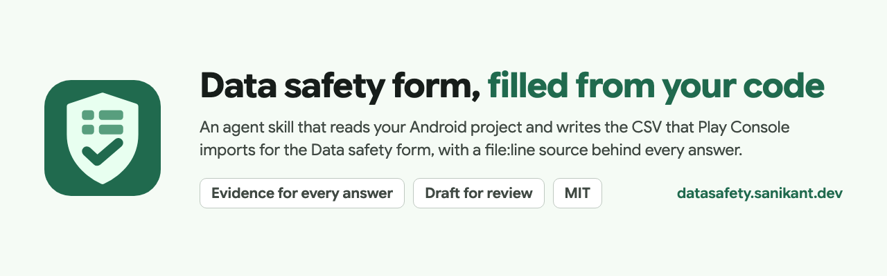
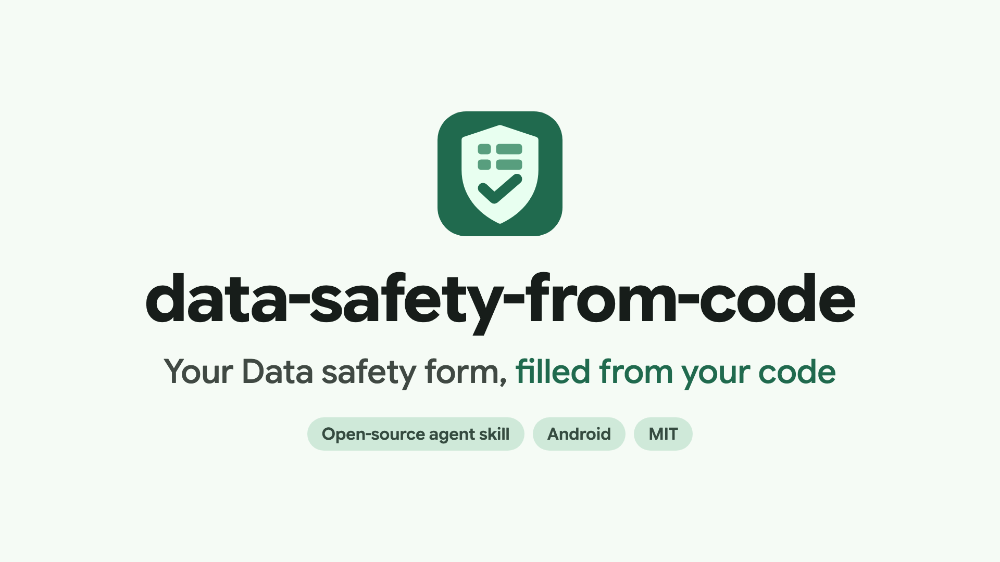
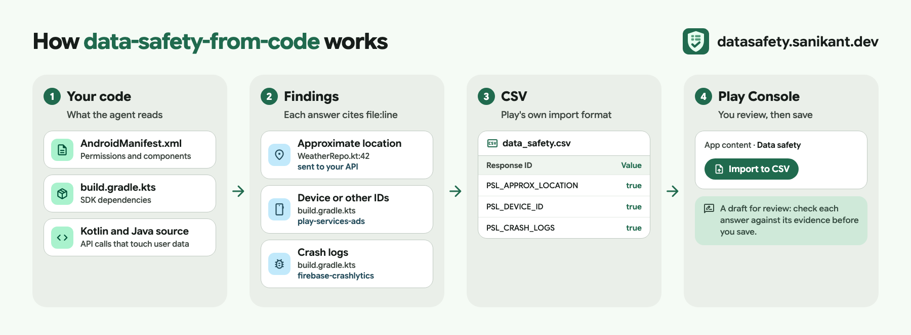

<p align="center">
  <a href="https://datasafety.sanikant.dev/"></a>
</p>

<p align="center">
  <a href="https://datasafety.sanikant.dev/"><b>Docs</b></a> ·
  <a href="https://datasafety.sanikant.dev/getting-started/">Get started</a> ·
  <a href="https://datasafety.sanikant.dev/sdk/">SDK answers</a> ·
  <a href="https://datasafety.sanikant.dev/guides/how-to-fill-data-safety-form/">Guides</a>
</p>

<p align="center">
  <a href="https://github.com/sanikantv/data-safety-from-code/actions/workflows/test.yml"></a>
  <a href="LICENSE"></a>
</p>

# data-safety-from-code

An agent skill that scans your Android codebase and writes the **Google Play Data safety form as a CSV** that Play Console can import. Every answer comes with evidence: the file and line that justify it, or the SDK vendor's own disclosure page.

[](https://datasafety.sanikant.dev/media/intro.mp4)

> **A draft for review, not a compliance guarantee.** Google holds you, the developer, responsible for your Data safety declaration. The skill shows you why it gave each answer and lists what it could not verify, such as what your backend does with the data.

## Why

Play Console's Data safety form has 782 possible answers, and most of what an app collects comes from SDKs you didn't write. Questionnaire tools ask you what your app does; this skill reads the code:

- **SDKs**: dependencies from `build.gradle(.kts)`, version catalogs and (optionally) `./gradlew dependencies`, matched against a [knowledge base](skills/data-safety-from-code/knowledge/sdks.yaml) where each entry cites the vendor's Play disclosure.
- **Your own code**: HTTP clients, uploads, Firestore writes, analytics events, AI requests, sign-in methods, identifiers, plain `http://` URLs, unused sensitive permissions.
- **Google's rules**: collected vs shared, service providers, ephemeral processing, IP address as location, Play Billing. The agent follows [these definitions](skills/data-safety-from-code/knowledge/definitions.md).

## How it works



1. `scan.py` reads manifests, Gradle files, the version catalog, source and network security config, and writes `findings.json`. Python 3.9+, standard library only, no network calls.
2. Your agent follows each flagged code path and asks you only what code can't show: privacy policy, account creation and deletion, server-side sharing, which data is optional.
3. `draft.py` merges SDK data, the agent's decisions and your answers. `fill_csv.py` writes them into Google's template, changing only the *Response value* column, so the import works.
4. `validate.py` checks every conditional question. `report.py` writes `data_safety_report.md` with the evidence for each answer and the changes against your current form ([example](skills/data-safety-from-code/examples/report_example.md)).

## Install

**Claude Code**

```text
/plugin marketplace add sanikantv/data-safety-from-code
/plugin install data-safety-from-code@data-safety-from-code
```

**Codex, Cursor, Copilot and other SKILL.md agents**

```bash
npx --yes skills add sanikantv/data-safety-from-code --skill data-safety-from-code -y
```

**Or copy the folder**

```bash
git clone https://github.com/sanikantv/data-safety-from-code.git
cp -r data-safety-from-code/skills/data-safety-from-code ~/.claude/skills/
```

## Use

1. In Play Console: **App content → Data safety → Export to CSV** (your backup, and the latest template).
2. In your Android project, ask your agent:

   ```text
   /data-safety-from-code fill the Data safety form for this app. My current export is ~/Downloads/data_safety_export.csv
   ```

3. Answer its questions, then read `data-safety/data_safety_report.md`.
4. In Play Console: **App content → Data safety → Import to CSV**, choose `data-safety/data_safety.csv`, check the preview, save and submit.

Importing replaces every answer in the form. Export first.

## SDKs covered

Firebase Analytics, Crashlytics, Authentication, Firestore, Cloud Messaging, Performance Monitoring, Remote Config, Installations and AI Logic · AdMob · Google UMP · RevenueCat · Play Billing · Sign in with Google / Credential Manager · ML Kit · OneSignal · Facebook SDK · Sentry · Mixpanel · OpenAI clients · Gemini (Google AI client SDK).

12 of the 21 entries come from the vendor's official Play data disclosure; the rest are marked `inferred` and always land in the report's review list. Each has a page: [datasafety.sanikant.dev/sdk](https://datasafety.sanikant.dev/sdk/).

## Repository

| Path | What |
|---|---|
| `skills/data-safety-from-code/` | The skill: `SKILL.md`, scripts, knowledge base, Google's CSV template |
| `tests/` | Four fixture Android apps with golden CSVs, a round trip of a real export, validator cases |
| `site/` | Docs and landing site (Astro Starlight), deployed to datasafety.sanikant.dev |
| `video/` | The intro video (Remotion) and its voiceover script ([MEDIA.md](MEDIA.md)) |
| `art/` | Icon, social preview, banner, diagram (rendered from HTML) |

Run the tests:

```bash
python3 -m unittest discover tests
```

## Contributing an SDK

Add an entry to [`knowledge/sdks.yaml`](skills/data-safety-from-code/knowledge/sdks.yaml) with a link to the vendor's own Play data-disclosure page in `source` and `confidence: official`. Use `condition:` for data the SDK sends only in some setups. Then:

```bash
pip install pyyaml
python3 skills/data-safety-from-code/scripts/build_knowledge.py   # regenerates sdks.json, checks every ID
python3 -m unittest discover tests
```

## License

MIT. Google Play is a trademark of Google LLC. This project is not affiliated with Google.

Built by [Sanikant](https://sanikant.dev). More: [M3 Expressive Skill](https://expressive.sanikant.dev/).
